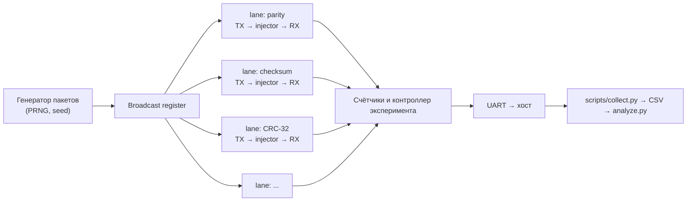

# Аппаратный модуль контроля целостности данных на FPGA

Командный учебный проект: реализация набора алгоритмов контроля целостности данных
на SystemVerilog, их верификация, создание измерительного стенда на ПЛИС
и сравнительный анализ алгоритмов по аппаратным затратам, производительности
и способности обнаруживать ошибки.

**Стек:** SystemVerilog · cocotb (Python) · Verilator · Python (анализ данных)

**Статус:** ядра и обёртки реализованы, регрессия cocotb (core / wrapper /
harness) проходит с оракулом против эталонных моделей; статические метрики
сняты синтезом Yosys ([docs/results/synthesis.md](docs/results/synthesis.md)).
Плата Terasic DE2-115 получена, собрана в Quartus и прошита: вендорные
Fmax / LE / FF приведены в [docs/results/board.md](docs/results/board.md).
Характеристики платы и чеклист bring-up — в [docs/board.md](docs/board.md);
кампании `MODE=0..9` на плате выполнены и совпали с симуляцией
([docs/results/board_campaigns.md](docs/results/board_campaigns.md)).

---

## Цели и задачи

1. Реализовать все основные классы алгоритмов контроля целостности данных.
2. Верифицировать каждый алгоритм против эталонных моделей на Python.
3. Получить плату FPGA и зафиксировать её характеристики.
4. Разработать топ-модуль (измерительный стенд) для автоматизированного
   получения данных о работе алгоритмов на реальной ПЛИС.
5. Провести сравнительный анализ полученных данных.

## Состав алгоритмов

| Класс | Варианты | Приоритет |
|-------|----------|-----------|
| Бит чётности | even / odd parity | обязательный |
| Контрольная сумма | checksum-8/16/32, вариант Internet (one's complement) | обязательный |
| Флетчер | Fletcher-16, Fletcher-32 | обязательный |
| Адлер | Adler-32 | обязательный |
| CRC | CRC-8, CRC-16/CCITT-FALSE, CRC-16/ARC, CRC-32 (Ethernet), CRC-32C | обязательный |
| Криптографический хеш | SHA-256 | расширенный трек |

MD5, SHA-1 и SHA-3 исключены из объёма (обоснование — [docs/decisions.md](docs/decisions.md), D-06).
Все CRC реализуются одним параметризуемым движком; аналогично checksum и Fletcher.

## Как это работает

Каждый алгоритм оформляется в пару модулей с единым потоковым интерфейсом:
генератор (добавляет тег целостности к пакету) и проверяющий модуль
(пересчитывает тег и выдаёт флаг ошибки).

Топ-модуль стенда подаёт одинаковый стимул на все алгоритмы параллельно,
инжектирует ошибки, собирает статистику и выдаёт результаты на хост через UART:



Подробности: [docs/architecture.md](docs/architecture.md), [docs/measurement_plan.md](docs/measurement_plan.md).

## Структура репозитория

```
fpga-integrity-module/
├── README.md
├── CONTRIBUTING.md
├── requirements.txt
├── rtl/
│   ├── cores/            # parity, checksum, fletcher, adler, crc (generic), sha256
│   ├── wrappers/         # единые TX/RX-обёртки алгоритмов
│   └── harness/          # стимулы, инжектор, счётчики, контроллер, UART
├── boards/               # board-зависимые топы, constraints и interactive demo (DE2-115)
├── tb/                   # cocotb: модели, directed/random/error-тесты
├── scripts/              # synth.py, collect.py, analyze.py, parse_reports.py, cov_report.py
├── syn/                  # Yosys-скрипты и отчёты синтеза (syn/reports/)
├── data/                 # сырые результаты измерений (CSV/JSON)
└── docs/                 # документация (см. ниже)
```

## Инструменты

- **RTL:** SystemVerilog (синтезируемое подмножество, без вендорных примитивов).
- **Симулятор:** Verilator ≥ 5.0 — самый быстрый RTL-симулятор, поддерживается cocotb.
- **Testbench:** cocotb + собственные AXI4-Stream source/sink (`tb/test_utils.py`),
  эталонные модели на Python; внешний `cocotbext-axi` не используется.
- **Синтез:** Yosys (в т.ч. WASM-сборка `yowasp-yosys`) даёт gate-equivalent
  метрики и число триггеров, [docs/results/synthesis.md](docs/results/synthesis.md).
- **САПР и кристалл:** Quartus Prime Lite 21.1, Cyclone IV E EP4CE115F29C7
  ([docs/board.md](docs/board.md)); Fmax и утилизация после P&R — в
  [docs/results/board.md](docs/results/board.md).

## Быстрый старт

```bash
sudo apt install verilator gtkwave python3-venv   # Verilator >= 5.0
python3 -m venv .venv && source .venv/bin/activate
pip install -r requirements.txt

# Цели проекта:
make lint       # verilator --lint-only -Wall (DATA_WIDTH 8/32/64)
make sim        # полная регрессия cocotb (core, wrapper, harness)
make sim-quick  # быстрый поднабор для локальной итерации
make cov        # регрессия + покрытие Verilator
make harness    # только симуляция стенда

# Сбор данных в симуляторе (скорость по тикам для каждого метода):
make sim-measure         # DATA_WIDTH=32 по умолчанию
make sim-measure-all     # DATA_WIDTH=8 и 32, один сводный отчёт
make sim-false-rate      # научные генераторы искажений: false/undetected rate
make sim-tag-rate        # искажение тега: проверка RX (data/sim_tag.csv)
make synth              # синтез Yosys: таблица аппаратных затрат
make cov-report         # суммарный отчёт по покрытию RTL

# Отдельные режимы регрессии:
python tb/run_tests.py --mode core|wrapper|harness|all --widths 8,32,64 [--quick] [--only NAME]
```

## Верификация

Самопроверяющиеся тесты против эталонных моделей (`zlib`, `crcmod`, `hashlib`),
граничные случаи, constrained-random, инжекция ошибок, покрытие кода.
План: [docs/verification_plan.md](docs/verification_plan.md).

## Стенд и измерения

Стенд автоматически прогоняет кампании (чистые данные, одиночные ошибки,
пакетные ошибки, перестановки байт и др.) по всем алгоритмам и собирает
метрики: латентность, пропускная способность, статистика обнаружения ошибок.
Статические метрики (LUT/FF, Fmax) снимаются отдельными сборками каждого ядра.
Методика: [docs/measurement_plan.md](docs/measurement_plan.md).

Сбор данных в симуляторе запускается командой `make sim-measure-all`: она
прогоняет детерминированную кампанию на шинах 8 и 32 бит, передаёт строки
`RESULT` через `scripts/collect.py` в `data/*.csv` и строит таблицу
`docs/results/summary.md` с метриками `ticks_per_byte`, `bytes_per_tick` и
`ticks_per_packet` для всех шести методов. Текущие результаты — в
[docs/results/summary.md](docs/results/summary.md).

Для измерения **false/undetected rate** используются генераторы с научной
методикой: модель пакетных ошибок Gilbert–Elliott (Gilbert 1960, Elliott 1963)
и адверсариальные векторы необнаруженных ошибок Купмана (HDLen, ICNP 2002).
Запуск: `make sim-false-rate`, отчёт —
[docs/results/false_rate/summary.md](docs/results/false_rate/summary.md).
Методика, DOI и ссылки: [docs/false_rate.md](docs/false_rate.md).

## План работ

- [x] **Этап 1.** Реализация алгоритмов (RTL-ядра + единые обёртки)
- [x] **Этап 2.** Верификация (unit → random → error-кампании → покрытие):
  114 конфигураций, 270/270 тестов, покрытие RTL 95.58 % (1277/1336 строк);
  фактические числа — [docs/coverage.md](docs/coverage.md) и
  [docs/test_report.md](docs/test_report.md)
- [x] **Этап 3.** Получение платы, фиксация характеристик: Terasic DE2-115,
  Cyclone IV E EP4CE115F29C7, стенд 12.5 МГц ([docs/board.md](docs/board.md))
- [x] **Этап 4.** Board-пакет (`boards/de2_115/`), прошивка через JTAG и UART-отчёт
  готовы; все кампании `MODE=0..9` на плате совпали с симуляцией
  ([docs/results/board_campaigns.md](docs/results/board_campaigns.md))
- [x] **Этап 5.** Анализ: синтез, симуляционные и вендорные метрики, данные
  кампаний с платы готовы ([docs/results/conclusion.md](docs/results/conclusion.md),
  [docs/results/board_campaigns.md](docs/results/board_campaigns.md))

Этапы 1–2 и разработка стенда в симуляции велись параллельно, не дожидаясь плату.
Критерии входа/выхода этапов: [docs/roadmap.md](docs/roadmap.md).

## Команда

Работа ведётся командой с разделением по трекам: RTL, верификация,
стенд/инфраструктура, анализ/документация. Процессы — [CONTRIBUTING.md](CONTRIBUTING.md).

## Документация

| Документ | Содержание |
|----------|------------|
| [docs/spec.md](docs/spec.md) | Техническая спецификация: интерфейсы, параметры алгоритмов, соглашения |
| [docs/architecture.md](docs/architecture.md) | Архитектура ядер, обёрток и стенда; board-абстракция |
| [docs/verification_plan.md](docs/verification_plan.md) | План верификации и критерии готовности |
| [docs/measurement_plan.md](docs/measurement_plan.md) | Методика измерений на плате и анализа данных |
| [docs/false_rate.md](docs/false_rate.md) | Научные генераторы искажений и измерение false rate |
| [docs/interactive_demo.md](docs/interactive_demo.md) | Интерактивная демонстрация хешей: пакет с ПК → FPGA → сравнение с Python |
| [docs/roadmap.md](docs/roadmap.md) | Этапы работ, зависимости, критерии |
| [docs/results/synthesis.md](docs/results/synthesis.md) | Статические метрики из Yosys (gate-equivalent, FF) |
| [docs/results/board.md](docs/results/board.md) | Вендорные метрики Quartus (Fmax, LE/FF) |
| [docs/results/board_campaigns.md](docs/results/board_campaigns.md) | Кампании на плате: sim ↔ board и тайминг по режимам |
| [docs/results/conclusion.md](docs/results/conclusion.md) | Итоговое сравнение и выводы |
| [docs/results/work_conclusions.md](docs/results/work_conclusions.md) | Итоговая оценка работы: статус, выводы и открытые вопросы |
| [docs/coverage.md](docs/coverage.md) | Фактическое покрытие RTL (слияние всех конфигураций) |
| [boards/README.md](boards/README.md) | План вендорного слоя и bring-up |
| [docs/board.md](docs/board.md) | Характеристики DE2-115 и чеклист bring-up (заполнен) |
| [docs/decisions.md](docs/decisions.md) | Журнал принятых решений |
| [CONTRIBUTING.md](CONTRIBUTING.md) | Workflow команды, стиль кода, правила ревью |

## Литература

- E. N. Gilbert, *Capacity of a Burst-Noise Channel*, BSTJ 39(5), 1960 —
  https://doi.org/10.1002/j.1538-7305.1960.tb03959.x
- E. O. Elliott, *Estimates of Error Rates for Codes on Burst-Noise Channels*,
  BSTJ 42(5), 1963 — https://doi.org/10.1002/j.1538-7305.1963.tb00955.x
- P. Koopman, *32-Bit CRC Codes for Internet Applications*, ICNP 2002 —
  https://doi.org/10.1109/ICNP.2002.1115615 · https://users.ece.cmu.edu/~koopman/crc/
- IEEE 802.3, Clause 3.2.9 — Frame Check Sequence
- R. Williams, *A Painless Guide to CRC Error Detection Algorithms*
- RevEng CRC catalogue — https://reveng.sourceforge.io/crc-catalogue/
- RFC 1071 — Computing the Internet Checksum
- RFC 1950 — Adler-32
- FIPS 180-4 — SHA-256
- cocotb — https://docs.cocotb.org · Verilator — https://verilator.org
