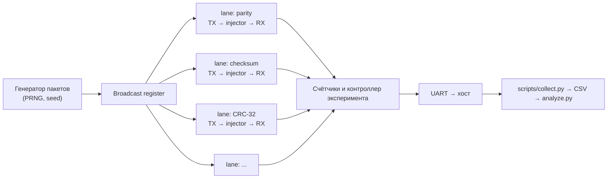

# Аппаратный модуль контроля целостности данных на FPGA

Командный учебный проект: реализация набора алгоритмов контроля целостности данных
на SystemVerilog, их верификация, создание измерительного стенда на ПЛИС
и сравнительный анализ алгоритмов по аппаратным затратам, производительности
и способности обнаруживать ошибки.

**Стек:** SystemVerilog · cocotb (Python) · Verilator · Python (анализ данных)

**Статус:** этапы 1–2 завершены: ядра и обёртки реализованы, регрессия
cocotb (core / wrapper / harness) проходит, стенд проверен в симуляции.
Модель платы ожидается — аппаратно-зависимые решения отложены и фиксируются
в [docs/board.md](docs/board.md).

---

## Цели и задачи

1. Реализовать все основные классы алгоритмов контроля целостности данных.
2. Верифицировать каждый алгоритм против эталонных моделей на Python.
3. Получить плату FPGA и зафиксировать её характеристики.
4. Разработать топ-модуль (измерительный стенд) для автоматизированного
   получения данных о работе алгоритмов на реальной ПЛИС.
5. Провести сравнительный анализ полученных данных.

## Состав алгоритмов

| Класс | Варианты | Приоритет |
|-------|----------|-----------|
| Бит чётности | even / odd parity | обязательный |
| Контрольная сумма | checksum-8/16/32, вариант Internet (one's complement) | обязательный |
| Флетчер | Fletcher-16, Fletcher-32 | обязательный |
| Адлер | Adler-32 | обязательный |
| CRC | CRC-8, CRC-16/CCITT-FALSE, CRC-16/ARC, CRC-32 (Ethernet), CRC-32C | обязательный |
| Криптографический хеш | SHA-256 | расширенный трек |

MD5, SHA-1 и SHA-3 исключены из объёма (обоснование — [docs/decisions.md](docs/decisions.md), D-06).
Все CRC реализуются одним параметризуемым движком; аналогично checksum и Fletcher.

## Как это работает

Каждый алгоритм оформляется в пару модулей с единым потоковым интерфейсом:
генератор (добавляет тег целостности к пакету) и проверяющий модуль
(пересчитывает тег и выдаёт флаг ошибки).

Топ-модуль стенда подаёт одинаковый стимул на все алгоритмы параллельно,
инжектирует ошибки, собирает статистику и выдаёт результаты на хост через UART:



Подробности: [docs/architecture.md](docs/architecture.md), [docs/measurement_plan.md](docs/measurement_plan.md).

## Структура репозитория

```
fpga-integrity-module/
├── README.md
├── CONTRIBUTING.md
├── requirements.txt
├── rtl/
│   ├── cores/            # parity, checksum, fletcher, adler, crc (generic), sha256
│   ├── wrappers/         # единые TX/RX-обёртки алгоритмов
│   └── harness/          # стимулы, инжектор, счётчики, контроллер, UART
├── boards/               # board-зависимые обёртки и constraints (после получения платы)
├── tb/                   # cocotb: модели, directed/random/error-тесты
├── scripts/              # gen_crc.py, collect.py, analyze.py, parse_reports.py
├── syn/                  # скрипты синтеза (после выбора САПР)
├── data/                 # сырые результаты измерений (CSV/JSON)
└── docs/                 # документация (см. ниже)
```

## Инструменты

- **RTL:** SystemVerilog (синтезируемое подмножество, без вендорных примитивов).
- **Симулятор:** Verilator ≥ 5.0 — самый быстрый RTL-симулятор, поддерживается cocotb.
- **Testbench:** cocotb + cocotbext-axi, эталонные модели на Python.
- **САПР и кристалл:** определяются после получения платы ([docs/board.md](docs/board.md)).
  До этого допускается предварительный синтез на произвольном кристалле
  только для отладки flow; такие результаты помечаются как предварительные.

## Быстрый старт

```bash
sudo apt install verilator gtkwave python3-venv   # Verilator >= 5.0
python3 -m venv .venv && source .venv/bin/activate
pip install -r requirements.txt

# Цели проекта:
make lint       # verilator --lint-only -Wall (DATA_WIDTH 8/32/64)
make sim        # полная регрессия cocotb (core, wrapper, harness)
make sim-quick  # быстрый поднабор для локальной итерации
make cov        # регрессия + покрытие Verilator
make harness    # только симуляция стенда

# Отдельные режимы регрессии:
python tb/run_tests.py --mode core|wrapper|harness|all --widths 8,32,64 [--quick] [--only NAME]
```

## Верификация

Самопроверяющиеся тесты против эталонных моделей (`zlib`, `crcmod`, `hashlib`),
граничные случаи, constrained-random, инжекция ошибок, покрытие кода.
План: [docs/verification_plan.md](docs/verification_plan.md).

## Стенд и измерения

Стенд автоматически прогоняет кампании (чистые данные, одиночные ошибки,
пакетные ошибки, перестановки байт и др.) по всем алгоритмам и собирает
метрики: латентность, пропускная способность, статистика обнаружения ошибок.
Статические метрики (LUT/FF, Fmax) снимаются отдельными сборками каждого ядра.
Методика: [docs/measurement_plan.md](docs/measurement_plan.md).

## План работ

- [x] **Этап 1.** Реализация алгоритмов (RTL-ядра + единые обёртки)
- [x] **Этап 2.** Верификация (unit → random → error-кампании → покрытие)
- [ ] **Этап 3.** Получение платы, фиксация характеристик ([docs/board.md](docs/board.md))
- [ ] **Этап 4.** Топ-модуль стенда (реализован и проверен в симуляции),
  bring-up на плате, автоматический сбор данных
- [ ] **Этап 5.** Анализ данных, сравнительные таблицы и графики, выводы

Этапы 1–2 и разработка стенда в симуляции ведутся параллельно, не дожидаясь плату.
Критерии входа/выхода этапов: [docs/roadmap.md](docs/roadmap.md).

## Команда

Работа ведётся командой с разделением по трекам: RTL, верификация,
стенд/инфраструктура, анализ/документация. Процессы — [CONTRIBUTING.md](CONTRIBUTING.md).

## Документация

| Документ | Содержание |
|----------|------------|
| [docs/spec.md](docs/spec.md) | Техническая спецификация: интерфейсы, параметры алгоритмов, соглашения |
| [docs/architecture.md](docs/architecture.md) | Архитектура ядер, обёрток и стенда; board-абстракция |
| [docs/verification_plan.md](docs/verification_plan.md) | План верификации и критерии готовности |
| [docs/measurement_plan.md](docs/measurement_plan.md) | Методика измерений на плате и анализа данных |
| [docs/roadmap.md](docs/roadmap.md) | Этапы работ, зависимости, критерии |
| [docs/board.md](docs/board.md) | Шаблон фиксации характеристик платы (заполняется при получении) |
| [docs/decisions.md](docs/decisions.md) | Журнал принятых решений |
| [CONTRIBUTING.md](CONTRIBUTING.md) | Workflow команды, стиль кода, правила ревью |

## Литература

- IEEE 802.3, Clause 3.2.9 — Frame Check Sequence
- R. Williams, *A Painless Guide to CRC Error Detection Algorithms*
- RevEng CRC catalogue — https://reveng.sourceforge.io/crc-catalogue/
- RFC 1071 — Computing the Internet Checksum
- RFC 1950 — Adler-32
- FIPS 180-4 — SHA-256
- cocotb — https://docs.cocotb.org · Verilator — https://verilator.org
