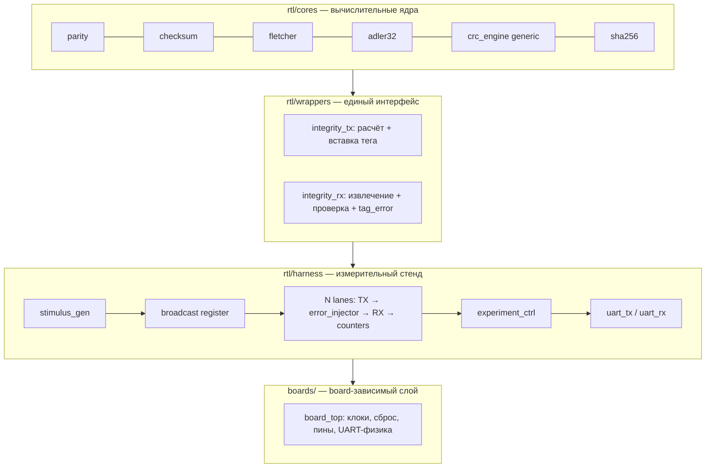

# Архитектура

## 1. Слои проекта



Принцип: всё, кроме `boards/`, не зависит от вендора и кристалла.
При получении платы добавляется только тонкая обёртка и constraints.

## 2. Ядра (`rtl/cores`)

Один параметризуемый движок на класс алгоритмов:

| Модуль | Параметры | Покрывает |
|--------|-----------|-----------|
| `parity_core` | `MODE` (even/odd) | бит чётности |
| `checksum_core` | `SUM_WIDTH`, `ONES_COMPLEMENT` | checksum-8/16/32, Internet |
| `fletcher_core` | `BLOCK_WIDTH` | Fletcher-16/32 |
| `adler32_core` | — | Adler-32 |
| `crc_engine` | `CRC_WIDTH`, `POLY`, `INIT`, `REFIN`, `REFOUT`, `XOROUT` | все CRC из спецификации |
| `sha256_core` | — | SHA-256 (расширенный трек) |

Параллельные CRC-уравнения (развёртывание LFSR на `DATA_WIDTH` бит)
генерируются скриптом `scripts/gen_crc.py`; сгенерированные файлы
хранятся в репозитории и помечаются как generated.

## 3. Обёртки (`rtl/wrappers`)

`integrity_tx` и `integrity_rx` параметризуются шириной тега и ссылкой
на ядро (через интерфейс/инстанс). Обеспечивают единые правила вставки/извлечения
тега, буферизацию хвоста, `busy`, `tag_value/tag_valid/tag_error`
согласно [spec.md](spec.md).

## 4. Стенд (`rtl/harness`)

| Блок | Назначение |
|------|------------|
| `stimulus_gen` | PRNG-генератор пакетов: seed, диапазон длин, детерминированное воспроизведение |
| `broadcast register` | удерживает beat, пока его не примут все lanes; гарантирует одинаковый поток и отсутствие повторного приёма |
| `error_injector` | режимы: clean, single-bit, burst (длина L), byte-swap, zero-insert; вставляется после TX каждого lane и искажает только payload, поэтому тег считается по чистым данным, а искажение одинаково для всех lanes |
| `lane[N]` | TX → error_injector → RX одного алгоритма + счётчики (см. measurement_plan) |
| `experiment_ctrl` | FSM: приём команды, запуск кампании, сбор счётчиков, выдача отчёта |
| `uart_tx/rx` | обмен с хостом; параметры по умолчанию 115200 8N1, финально — после платы |

Топ стенда `exp_harness_top` имеет board-независимые порты:
`clk`, `rst`, `uart_txd`, `uart_rxd`, опционально `leds` для bring-up.

## 5. Board-абстракция (`boards/`)

До получения платы каталог пуст (кроме шаблона). После получения:

```
boards/<board_name>/
├── board_top.sv      # инстанс exp_harness_top + клоки/сброс/пины
├── constraints.*     # xdc / sdc / pcf — зависит от САПР
└── README.md         # pinout, клоки, особенности (заполняется из docs/board.md)
```

Выбор САПР, кристалла и целевой частоты фиксируется в [board.md](board.md)
и журнале решений. До этого момента synthesis-flow не фиксируется.

## 6. Хост-часть (`scripts/`)

- `collect.py` — приём отчётов по UART (pyserial), сохранение в `data/*.csv`.
- `parse_reports.py` — извлечение LUT/FF/Fmax из отчётов САПР.
- `analyze.py` — таблицы и графики (pandas + matplotlib), экспорт в `docs/results/`.
