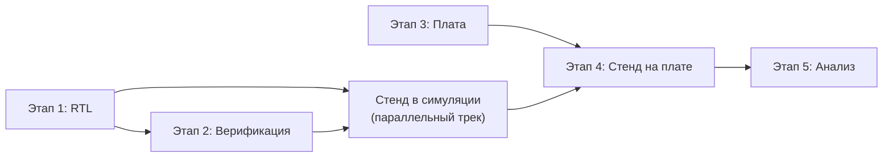

# План работ

Без календарных сроков; этапы связаны критериями входа/выхода.
Работа ведётся командой, треки параллелятся.

## Этап 1. Реализация алгоритмов
**Вход:** утверждена [spec.md](spec.md).
**Работы:** ядра parity/checksum/Fletcher/Adler/CRC; скрипт генерации CRC-уравнений;
единые TX/RX-обёртки; lint чистый. SHA-256 — отдельный расширенный трек.
**Выход:** все обязательные ядра синтезируемы, lint без замечаний, интерфейсы соответствуют спецификации.
**Статус:** выполнен.

## Этап 2. Верификация
**Вход:** ядра и обёртки готовы.
**Работы:** эталонные модели; directed → random → error-кампании → покрытие; CI.
**Выход:** критерии готовности из [verification_plan.md](verification_plan.md) выполнены;
референсные результаты error-кампаний сохранены.
**Статус:** выполнен. Регрессия core/wrapper/harness зелёная (94 конфигурации,
249/249 тестов), harness сверяется с эталонной моделью. Фактическое покрытие
RTL — **95.45 %** (1260/1320 строк, [docs/coverage.md](coverage.md)); порог
95 % достигнут. Отчёт: [docs/test_report.md](test_report.md).

## Этап 3. Получение платы
**Вход:** плата физически получена.
**Работы:** заполнение [board.md](board.md); выбор САПР и целевой частоты;
создание `boards/<name>/`; smoke-тест (мигание LED, UART loopback).
**Выход:** board-пакет готов, простейший проект собирается и шьётся.
**Статус:** ожидает получения платы.
**Примечание:** этапы 1–2 и разработка стенда в симуляции не ждут этот этап.

## Этап 4. Топ-модуль стенда и сбор данных
**Вход:** этапы 1–2 завершены; для финальной части — этап 3.
**Работы:** stimulus_gen, error_injector, lanes, счётчики, контроллер, UART;
верификация стенда целиком в симуляции; после платы — bring-up и прогоны кампаний;
хост-скрипты collect/parse/analyze.
**Выход:** автоматический сбор данных работает; результаты на плате совпадают с референсом из симуляции.
**Статус:** RTL стенда, счётчики, UART-отчёт и хост-скрипты готовы;
симуляция стенда проходит. Bring-up и прогоны на плате ожидают этап 3.

## Этап 5. Анализ
**Вход:** данные из стенда + отчёты САПР.
**Работы:** таблицы и графики по [measurement_plan.md](measurement_plan.md);
сравнительный анализ; оформление выводов и итоговых материалов.
**Выход:** заполнены все итоговые таблицы, сформулированы выводы о применимости алгоритмов.
**Статус:** скрипты `collect.py`, `parse_reports.py`, `analyze.py` готовы;
итоговые таблицы заполняются после получения данных с платы.

## Зависимости

